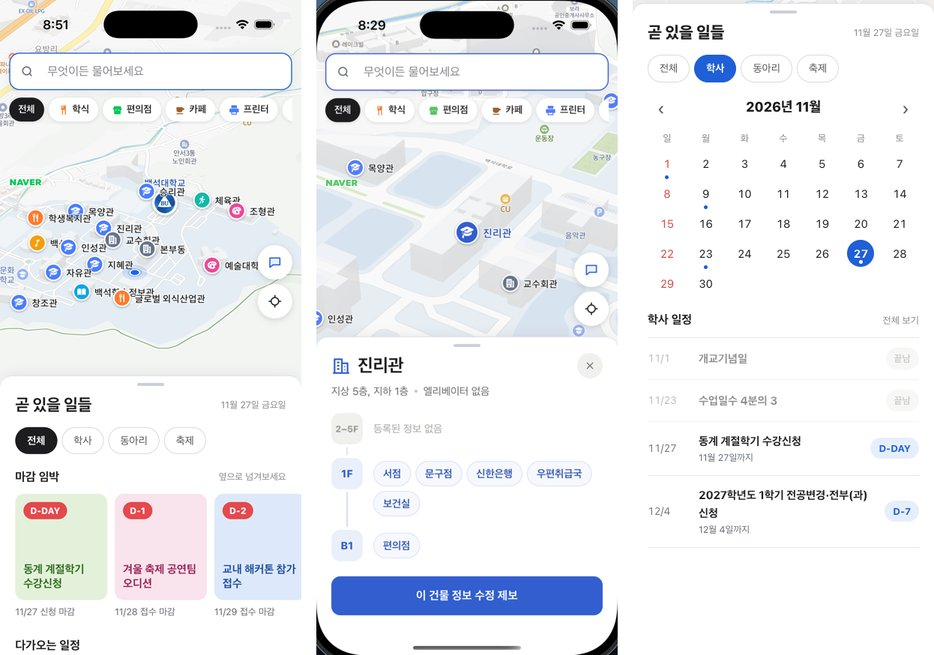

# 백석대 캠퍼스맵

백석대 학생이 지도 한 화면에서 건물, 학식, 학사일정을 보고, 틀린 정보는 직접 제보하는 캠퍼스 생활 지도입니다. 화면은 웹 하나로 만들고, iOS 앱은 그 화면을 네이버 3D 지도 위에 띄웁니다.



## 빠른 실행

필요한 것만 골라서 실행합니다.

**화면만 보기** (설치 없음, 예시 데이터)

```bash
cd web
python3 -m http.server 8765
```

→ <http://localhost:8765>

**서버까지 같이** (데이터 저장, 관리자, 학식 메뉴)

```bash
cd server
pip install -r requirements.txt
python seed.py      # 처음 한 번: DB 만들기
python app.py
```

→ <http://localhost:8000> (화면도 같이 열립니다. 관리자 계정 `admin` / `admin1234`)

맥에서 `python`이 없다고 나오면 `python3`, `pip3`로 실행합니다.

**iOS 앱** (맥 + Xcode)

`ios/CampusMap.xcodeproj`를 열고 실행합니다. 내 맥에서 서버가 켜져 있으면 앱이 그 서버를 쓰고, 꺼져 있으면 예시 데이터로 동작합니다.

## 네이버 지도 키

키가 없어도 임시 지도로 모든 기능이 동작합니다. iOS 앱에서 3D 지도를 보려면:

1. `ios/Config/Secrets.xcconfig.example`을 복사해 `Secrets.xcconfig`로 이름을 바꿉니다.
2. 안에 `NAVER_MAP_NCP_KEY_ID = 팀키`를 적습니다. 팀 키는 단톡에 있습니다.
3. 다시 빌드합니다.

브라우저에서 네이버 지도를 보려면 `web/js/config.js`에 같은 키를 넣고 `localhost`로 엽니다. 이 파일은 깃에 올라가니 키를 넣은 채로 커밋하지 않습니다.

`Secrets.xcconfig`는 깃에 올라가지 않습니다. 저장소가 공개라서 키는 단톡에서만 주고받습니다. 번들 ID(`com.example.campusmap`)는 키에 등록된 값이라 바꾸지 않습니다.

## 어디를 고치면 되나

| 고치고 싶은 것 | 파일 |
|---|---|
| 화면 흐름, 하단 시트, 건물 카드 | `web/js/app.js` |
| 색, 글자, 간격 | `web/css/style.css` |
| 지도, 마커 | `web/js/map.js` (앱의 3D 지도는 `ios/CampusMap/NativeMap.swift`) |
| 건물, 식당, 일정 데이터 | `web/js/data.js`와 `server/seed.py` (같은 내용이라 둘 다 고칩니다) |
| 검색창, 챗봇 AI | `web/js/chatbot.js`, `server/chatbot.py` |
| API, DB | `server/app.py`, `server/schema.sql` ([서버 문서](server/README.md)) |
| 학식 메뉴 자동 채우기 | `server/menu_auto.py` |

## 알아둘 것

- 서버가 꺼져 있으면 화면은 `web/js/data.js`의 예시 데이터로 동작합니다.
- `server/schema.sql`이 바뀐 걸 받았으면 `python seed.py --reset`으로 DB를 다시 만듭니다.
- iOS 앱은 맥에서만 빌드됩니다. 윈도우에서는 `web/`만 고쳐도 앱 화면에 그대로 들어갑니다.
- 키와 비밀번호는 커밋하지 않습니다. `Secrets.xcconfig`, `.env`, DB 파일은 자동으로 제외됩니다.
- AI API 키는 웹 코드에 넣지 않고 서버 환경변수로만 읽습니다.
